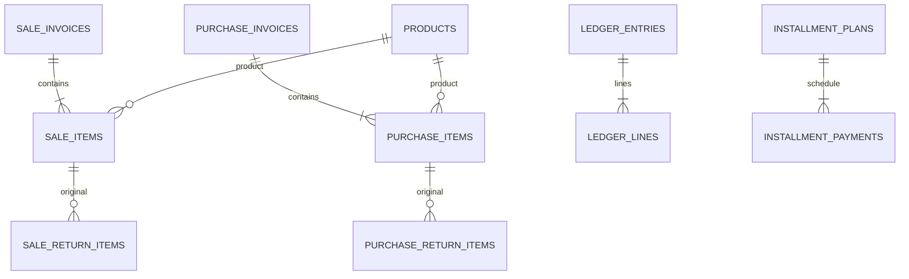

# المخطط 16 والترقية والتعافي

## الدلالات والقيود

المخطط يتكون من 28 جدولًا و 204 أعمدة. المبالغ قروش integer موقّع 64 بت؛ الحساب الوسيط BigInt والتحويل إلى التخزين checked. لا تحويل REAL إلى integer ولا تقريب تاريخ مالي ولا إعادة ترقيم معرفات.

| الإصدار | التغيير |
|---|---|
|14| حراسة typeof/NULL/boolean والقيم عند INSERT و UPDATE ، qty موجب، وردية مفتوحة واحدة، خطة واحدة لكل مستند، وافتتاحية واحدة لكل هدف مع NULL واضح؛ فهارس البنود والمراجع |
|15| operation_receipts بمفتاح كامل و ready/blocked و raw_payload ؛ مستودع موحد يفحص المصدر الجديد والقديم قبل replay |
|16| ledger_entries.posting_state: draft→posted ، اتزان ومقدار موجب قبل الاعتماد، تجميد القيود وسطورها، مراجع منطقية أمامية وعكسية، وتجميد الأجزاء المالية للمستند المعتمد |



الرسم يعرض روابط مختارة. owner_type/reference_type/result_kind روابط منطقية بعقود صريحة وليست كلها FK. shifts.opening_ledger_entry_id حد تسلسل وقد يكون 0 ؛ لا يمثل ملكية لقيد.

paid_minor و remaining_minor على الفاتورة قيم الإصدار. الرصيد الحالي من الخطة والتحصيلات والمرتجعات. payments ذات cash/wallet تحصيل فعلي؛ علامات installment التاريخية تُحفظ لكنها لا تدخل جمع النقد المسدد عند الإصدار. أساس تكلفة المخزون والبنود cost_minor دقيق وقد يختلف عن الكمية×المتوسط المدور.

## اعتماد الدفتر

العملية المالية تكتب المستند والمخزون والسطور والإيصال في المعاملة نفسها. _postLedger يتحقق من اتزان القيد، مجال صافي الحساب، والإشارة الطبيعية للإيرادات/الموردين ومجال الطرف، ثم يحول draft إلى posted. الفشل يعيد المعاملة كلها؛ لا إيصال نجاح قبل الاعتماد.

| محاولة SQL | السلوك |
|---|---|
| اعتماد قيد فارغ/صفري/غير متزن أو مجموع سطوره يفيض | رفض |
| UPDATE/DELETE لرأس أو سطر posted ؛ إلحاق سطر؛ نقل سطر منه أو إليه | رفض |
| REPLACE/UPSERT أو UPDATE OR REPLACE يتعارض مع معرف تاريخ معتمد | رفض |
| إلحاق دفعة إصدار أو حركة مخزون بفاتورة/مرتجع معتمد | رفض |
| إلحاق تحصيل مشروع لنفس installment_plan | مسموح من خلال المعاملة المالية والإيصال؛ لا فهرس فريد عام يحظر تحصيلات متعددة |
| إعادة اعتماد نفس مصدر مستند | فهرس جزئي يمنع التكرار؛ يستثني installment_payment لأن مرجعه خطة مشتركة |
| SQL خارجي يحفظ draft دون اعتماد | قد يلتزم؛ يغيب عن الأرصدة التشغيلية، يظهر في التدقيق، وتُرفض نسخة تحوي draft عند قبولها |

كل قارئي الدفتر التشغيليين يستخدمون posted ، بما في ذلك_accountNet والطرف والوردية والتقارير والسجل. التدقيق يقرأ الحالتين ويكشف ledger_unposted. SQLite لا يملك CHECK مؤجلًا لاتزان مجموعة حتى COMMIT ؛ لا ادعاء بمنع كل كتابة خارج التطبيق أو بربط كل payment مفردة بقيدها حين يكون المرجع plan.

recursive_triggers=ON لكل اتصال تطبيق. الحراسة الصريحة تغطي تصادمات المعرف و UPSERT ، وحراسة AFTER INSERT تميز المعرف المخصص فعليًا عن sentinel=-1. تحفظ معرفات-1 التاريخية أثناء الترقية ولا تعطل AUTO INCREMENT ؛ محاولة INSERT/REPLACE جديدة بمعرف-1 ترفض بعد التخصيص وتُعاد ذرّيًا، بما فيها الحذف الضمني. لا يعمم ذلك ضمانًا مستقلًا عن PRAGMA لكل مفتاح UNIQUE بديل؛ يبقى recursive_triggers شرط اتصال مدعومًا ومختبرًا.

رؤوس الفواتير/المرتجعات والتصحيحات والجرد والافتتاحيات وأجسام البنود المالية تصبح غير قابلة للتعديل بعد posting. اسم/سعر الصنف الحالي وبيانات العميل الوصفية يمكن تحديثها دون إعادة كتابة snapshot الهوية التاريخية. paid/total/status للخطة وجدول الاستحقاق تتغير فقط عبر مسارات التحصيل/المرتجع؛ هوية مالك الخطة والطرف ثابتة. المدفوعات وحركات المخزون تاريخ لا يحرر أو يحذف كتصحيح.

## سياسة القبول والتحذير

| النتيجة | القرار |
|---|---|
| نوع تخزين/NULL/boolean/عمود/PK/FK/UNIQUE غير مطابق، مبلغ/مقدار خارج المجال | مانع قبل DDL أو قبل اعتماد المرشح |
| كمية مخالفة، أكثر من وردية مفتوحة، خطة/افتتاحية مكررة، مرجع يتيم أو طرف خطة يخالف مستندها | مانع؛ لا حذف أو دمج تلقائي |
| دفتر غير متزن/مسودة عالقة، مصدر posting مكرر، سلسلة حركة موجودة لا تطابق الكمية الحالية، مرتجع يخالف بند الأصل أو يتجاوز الكمية | مانع |
| بنود/مدفوع نقدي/إجمالي إصدار أو جدول أقساط غير مطابق | مانع؛ الجدول المفقود يحتاج معالجة دعم ولا يخترع موعد استحقاق |
| legacy_backfill لهوية الصنف | وصف تاريخي محفوظ؛ لا يعاد تفسيره كهوية وقت الإصدار |
| فرق إجمالي قديم بين قيمة الأصناف وحساب inventory | يُحفظ كما هو في migration_baselines مع source_version ، ولا يُصلح تلقائيًا؛ يقبل نفس الفرق فقط بعد ذلك ويظل ظاهرًا في التدقيق |
| رصيد افتتاحي تاريخي بلا حركات | يظهر stock_untracked_balance في التدقيق؛ لا يُختلق تاريخ حركة. وجوده لا يثبت سبب الرصيد أو صحته |
| إيصال قديم مجهول/تالف، أو تعارض مصدرين | يحتفظ بالمفتاح والنص والحاجز؛ لا يسمح بإعادة تنفيذ تلك العملية. يمكن نسخ الأدلة مع استمرار تشخيصها |

baseline ليس إثباتًا لسبب الفرق أو مطابقة كل منتج. الترقية لا تصلح التاريخ ولا تغني عن تسوية فرق المحل بمستند ومراجعة. رفض مرشح يحافظ على الأصل؛ لا يعني أن الاسترجاع إلى إصدار أقدم مسموح.

## بروتوكول الترقية

1. تحت قفل العملية: استعادة restore غير المكتمل إن وجد، ثم فحص علامات migration قبل السماح بإنشاء أي ملف جديد. فقد الملف الحي مع pending لا ينشئ محلًا فارغًا.
2. VACUUM INTO إلى snapshot خاص، فحص SQLite والإصدار و SHA256 ، ثم نشر prepared. يبدأ migrating قبل أي تغيير DDL.
3. فحص خام بحسب الإصدار؛ ترقيات Drift داخل معاملة. backfill قبل 10 يحسب BigInt قبل الكتابة ولا يعتمد على ضرب SQLite.
4. Drift يكتب user_version بعد beforeOpen. QueryInterceptor ينتظر ensureOpen الفعلي ثم يفحص جميع الصفوف والأعمدة الأصلية وأنواعها وتسلسل AUTOINCREMENT ، وتعريفات القيود والفهارس والبيانات المضافة والعقود المنطقية.
5. نشر accepted قبل حذف العلامات، وحذفه آخرًا. رقم user_version وحده لا يعد قبولًا. قبول مكتمل لا يسترجع snapshot قديمة فوق معاملات لاحقة.
6. الانقطاع قبل القبول: استعادة snapshot المتحقق منها والامتناع الآمن. يحتفظ بتقرير محدود migration-pending.diagnostic.json يتضمن code/object/from/to فقط دون SQL أو قيم مالية أو بيانات شخصية؛ تعذر كتابة التقرير لا يفتح الكتابة.

النسخ DB و ZIP تكتب إلى staging ، تتحقق ثم flush وتنشر باسم عشوائي لا يصطدم بثبات الساعة. ZIP تُقرأ وتُستخرج للتحقق من CRC/الأحجام و SHA للقاعدة والصور قبل النشر. الملفات التالفة/المستقبلية/ناقصة المخطط تبقى للتشخيص ولا تحسب ضمن سياسة التقليم، والنسخة الجديدة المتحققة لا يقلمها تاريخ مستقبلي لملف أقدم. فحص العرض له cache metadata ؛ التقليم يعيد التحقق دون الاعتماد على cache.

## مسار الدعم دون الكتابة على الأصل

أغلق التطبيق وكل اتصالات القاعدة أولًا. شغّل الأداة من مجلد Flutter ، باستخدام Dart مع أصول sqlite3 المثبتة:

```bash
dart run tool/export_migration_recovery.dart LIVE_DB EXPORT_DIRECTORY
```

تأخذ الأداة قفل العملية. تقبل حالة failed بعد استعادة المصدر فقط، وعقود target 13/14/15/16 المعلنة. تتحقق من hash و from/to/target ومن محتوى الملف الحي مقابل snapshot ، ثم تُصدر نسخة في مجلد جديد مع أرشيف الأدلة. لا تمسح علامات الأصل ولا تختار مسار التطبيق تلقائيًا. لا تتجاوز target mismatch في الفتح العادي.

اختيار مسار التشغيل المستعاد وترقيته وتأكيد بياناته إجراء دعم منفصل. لا تُنقل النسخة فوق الأصل ولا تُحذف الحراسة يدويًا. وجود معاملات أحدث، أو فساد ملف سبق قبوله، يتطلب إصلاحًا أماميًا يحفظ الجديد؛ لا rollback تلقائيًا.

اختبارا الدعم التاليان يستخدمان ملفات مؤقتة فقط:

```bash
dart run tool/check_migration_recovery.dart
dart run tool/check_migration_process_recovery.dart
```

الأول يثبت التصدير وحفظ hashes والعلامات ورفض قفل عملية نشطة. الثاني يقتل عملية Dart فعلية بـ SIGKILL بعد accepted وأثناء حذف الملف الحي في التعافي، ثم يتحقق من حفظ البيانات والامتناع الآمن وعدم إنشاء محل فارغ.

## حدود التحقق

fixtures 3–13 موثقة؛ أعيد بناء 3 و 6 من تسلسل الترقية الأصلي لعدم وجود commit مستقل. البقية من تعريفات و generated metadata الأصلية. snapshots 14/15/16 توثق التغييرات الحالية غير المنشورة. اختبار المسارات المباشرة 3–15→16 لا يثبت تشغيل binaries تسلسلية 13→14→15→16 ؛ لم تصدر المراحل الوسيطة إلى الإنتاج.

التحقق من انقطاع العملية ورفض I/O لا يعد اختبار انقطاع كهرباء. تستخدم الملفات flush+rename دون بروتوكول directory-fsync محمول مثبت؛ يبقى اختبار التخزين والانقطاع على جهاز التسليم مطلوبًا. بناء Linux محجوب بأصل Flutter GTK غير المتاح من storage.googleapis.com. لم يُنفذ بناء أو تشغيل Windows. لا نشر للبيئة ولا تعديل لقاعدة محل فعلية ضمن هذا العمل.
